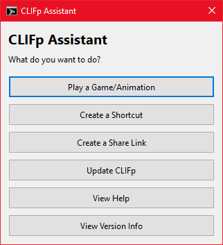

# CLIFp (Command-line Interface for Flashpoint)

CLIFp (pronounced "Cliff-P", or just "Cliff") is an alternative launcher for [Flashpoint Archive](https://flashpointarchive.org/) that focuses on speed and simplicity while providing access to a Flashpoint's vast library via a ripe command-line interface. This greatly increases the flexibility of Flashpoint by allowing for more direct integration with other software, such as Steam, LaunchBox, or any arbitrary application/script (see [Flashpoint Importer for Launchers](https://github.com/oblivioncth/FIL) for an example). The functionality of CLIFp should be near identical to the standard launcher for the facilities it implements.

Other than a few pop-up dialogs used for alerts and errors, CLIFp runs completely in the background so that the only windows seen during use are the same ones present while running standard Flashpoint. It automatically terminates once the target application has exited, requiring no manual tasks or clean-up by the user.

## Quickstart

Download the <a href="https://oblivioncth.github.io/CLIFp/select-artifact.html" target="_blank" rel="noopener noreferrer"> latest recommended release</a> and extract `CLIFp.exe` (`clifp` on Linux) within the `bin` folder to the root of your Flashpoint directory (Ignore `CLIFp-c`), then follow the usage examples below.

See [RELEASE-BUILDS](doc/RELEASE-BUILDS.md) for guidance on selecting your own, for example if you need a download for another machine. 

> [!NOTE]
> The regular Flashpoint Launcher does not have to be running to use CLIFp (and it's generally advantages to **NOT** have it running).

### Guided Usage

> [!TIP]
> For the most user-friendly introduction to CLIFp, simply double-click on `CLIFp.exe` to access a GUI-based "Assisted Mode".

### Basic Command-line Usage

Play a game:

    # By title
    CLIFp play -t "Simple, Tasty Buttons"

    # By UUID
    CLIFp play -i 37e5c215-9c39-4a3d-9912-b4343a17027e

    # Random
    CLIFp play -r any

Play an additional app:

    CLIFp play -t "Railroad Rampage" -s "Unlimited Health / Ammo Hack"

Create a desktop shortcut:d

    CLIFp link -t "Skill Archer"

Create a share link for other users

    # Enable CLIFp to open share links (only needs to be done once)
    CLIFp share -c

    # Create link to game
    CLIFp share -t "The Ultimate Showdown of Ultimate Destiny"

Update:

    CLIFp update

See [USAGE](doc/USAGE.md) for more details.

## Support

Please submit any possible bugs or issues with using the software to the [repository's issue tracker](https://github.com/oblivioncth/CLIFp/issues). If you really don't want to use GitHub, you can ping me in the Flashpoint Discord.

In either case, make sure you attach your `CLIFp.log` file, which may be named differently depending on the exact version you're using.

## Compatability

### General

Most flashpoint features are supported. The regular launcher still must be used for the following:
- Changing user configuration, like preferences, playlists, etc.
- Updating the launcher and downloading game updates

See the [Full Commands + Options Documentation](doc/COMMANDS.md) section for more information.

While constantly testing for complete compatibility is infeasible given the size of Flashpoint, CLIFp was designed with full compatibility in mind and theoretically is 100% compatible with the Flashpoint collection.

### Version Matching
Each release of this application targets a specific version series of Flashpoint Archive, which are composed of a major and minor version number, and are designed to work with all Flashpoint updates within that series. For example, a FIL release that targets Flashpoint 10.1 is intended to be used with any version of Flashpoint that fits the scheme `10.1.x.x`, such as `10.1`, `10.1.0.3`, `10.1.2`, etc, but **not**  `10.2`.

Using a version of CLIFp with a version of Flashpoint different than its target version is discouraged as some features may not work correctly or at all and in some cases the utility may fail to function entirely; **however**, given its design, CLIFp is likely to continue working with newer versions of FP that are released without requiring an update, unless that new version contains significant technical changes.

The title of each [release](https://stackedit.io/github.com/oblivioncth/CLIFp/releases) will indicate which version of Flashpoint it targets.

Updates will always be set to target the latest Flashpoint release, even if they were not created explicitly for compatibility reasons.

## Usage

See [USAGE](doc/USAGE.md) 

## Features

### Companion Mode

It is recommended to only use CLIFp when the regular launcher isn't running as it allows fully independent operation since it can start and stop required services on its own; however, CLIFp can be started while the standard launcher is running, in which case it will run in "Companion Mode" and utilize the launcher's services instead.

The catch with this mode is that CLIFp will be required to shutdown if at any point the standard launcher is closed.

### Ultimate Archive Data Support

CLIFp supports loading games from `Data/ArchiveData` like newer Flashpoint Launcher versions, but with a key difference; after game data is located within an ArchiveData segment, instead of being used directly from within the archive, that data will first be extracted to the usual location on disk. This does mean that space utilization will increase over time, though the effect is negligible unless you're playing many thousands of games in a short span of time.

The ability to use the files directly from the archive will be added at a later time; however, do keep in mind that the current method means that previously started games will load faster the next time they are played since they will have already been extracted. This makes a significant difference with CLIFp in particular due to its "run on demand" paradigm, as it has to load the metadata from all archive data each time it is ran, versus the standard launcher which loads this data once at startup and then can utilize it multiple times until you close Flashpoint.

### Other Features
- CLIFp displays a system tray icon so that one can be sure it is still running. This icon also will display basic status messages when clicked on and features a context menu with an option to exit at any time. The functionality of the tray icon may be expanded upon in future releases
- There is a second frontend included in releases named `clifp-c`, which features fully bi-directional CLI where all output is printed to the console and no UI windows are created. This version does not feature the system tray icon (see [FRONTENDS](docs/FRONTENDS.md))

## All Commands/Options

See [COMMANDS](doc/COMMANDS.md). 

## Limitations

 - Although general compatibility is quite high, compatibility with every single title cannot be assured. Issues with a title or group of titles will be fixed as they are discovered

## Source

### Summary

 - C++20
 - CMake >= 3.24.0
 - Targets:
	 - Windows 10+
	 - Linux

See [BUILDING](docs/BUILDING.md) for how to build the tool locally.

## More Information

For additional information, look within the [doc folder](doc/TOC.md).